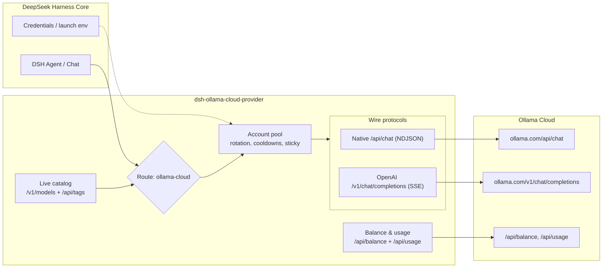

# 📦 @goodandready/dsh-ollama-cloud-provider

<div align="center">

<h3>Ollama Cloud LLM Provider for DeepSeek Harness</h3>

<p>
  <a href="https://goodandready.app/"></a>
  <a href="https://www.npmjs.com/package/@goodandready/dsh-ollama-cloud-provider"></a>
  <a href="https://github.com/GooDAnDReaDY/dsh-ollama-cloud-provider/blob/main/LICENSE"></a>
</p>

</div>

<table align="center">
  <tr>
    <td align="center">
      ⭐ <strong>If you like this plugin, please star it on GitHub</strong> — it shows me that the plugin is useful to you and motivates me to keep developing it.
      <br><br>
      🐛 <strong>If you find a bug or would like to request a feature</strong>, open a GitHub issue in any language — I will review your proposal and implement useful suggestions in a future plugin version.
    </td>
  </tr>
</table>

---

Ollama Cloud provider plugin for [DeepSeek Harness](https://deepseek-harness.github.io/deepseek-harness/) (dsh).

It registers one native LLM route, `ollama-cloud`, served by `https://ollama.com`, with two wire protocols:

| Transport | Endpoint | When |
|---|---|---|
| `native` (default) | `POST /api/chat` | thinking, tool calls, usage counters |
| `openai-chat` | `POST /v1/chat/completions` | OpenAI-compatible deployments and fallback |

Requests resolve the key per call, so a changed credential reaches the next request without a restart.

## Architecture



## Features

- **Two wire transports** chosen per model: the native Ollama API (NDJSON) and the OpenAI-compatible gateway (SSE).
- **Text, thinking, tool calls, images, usage and finish reasons** on both transports.
- **Live catalog** from `GET /v1/models`, enriched with capability flags from `GET /api/tags`.
- **Accurate limits** for the dsh picker: context window, input modalities, reasoning levels and their default, tool support, and API visibility.
- **Balance and usage** from the official `/api/balance` and `/api/usage` endpoints: included credits, purchased credits, 24-hour / 7-day / 30-day spend, and spend by model.
- **Multi-account rotation** before any content is streamed: 401/403/429 and quota rejections mark a key and retry with the next one. Cooldowns persist across restarts.
- **Sticky accounts** per conversation, plus model → account glob rules.
- **Price estimates** from the published Ollama pricing table, including off-peak rates, with per-model overrides.
- **Browser UI**:
  - **Settings → Ollama Cloud**: key, balance, accounts, rules, model allowlist, per-model transport, connection settings.
  - **Sidebar quota card** (off by default, and it does not poll `/state` while disabled): a ring with the highest used window and rows with remaining credits or legacy windows; an optional `planLabel` is shown next to the provider name.
  - **Center quota panel**: spend windows, spend by model, accounts, routing trace, usage analytics and a request heatmap.
- **`/ollama` command** for status, usage, balance, accounts, models, rules and `test [model]`.
- **TUI settings section** for terminal profiles.
- **One-click plugin update** in Settings → Ollama Cloud.

## Install

Build and pack first:

```bash
npm install
npm run build
npm pack
```

Install the published package:

```bash
dsh plugin --profile web add @goodandready/dsh-ollama-cloud-provider@0.1.8
# DSH Desktop:
dsh plugin --profile desktop add @goodandready/dsh-ollama-cloud-provider@0.1.8
```

Or install the packed tarball into a profile:

```bash
dsh plugin --profile web add /absolute/path/to/goodandready-dsh-ollama-cloud-provider-0.1.8.tgz
# DSH Desktop:
dsh plugin --profile desktop add /absolute/path/to/goodandready-dsh-ollama-cloud-provider-0.1.8.tgz
```

Restart dsh (or DSH Desktop), then pick **Ollama Cloud** in the model picker.

> **Use the tarball, not the directory.** On dsh 0.2.1-rc.2/rc.3 the Desktop CLI aliases a local
> directory passed to `dsh plugin add` and overwrites the target's `package.json`.

## Configure

```yaml
- id: llm-ollama-cloud
  name: "@goodandready/dsh-ollama-cloud-provider"
  config:
    apiKeyEnv: OLLAMA_API_KEY      # default
    # apiKey: ...                  # composition only, never commit
    transport: native              # native | openai-chat
    requestTimeoutMs: 300000
    streamIdleTimeoutMs: 300000
    visibleModels: []
    modelTransports: {}
    # contextWindowOverrides: { "model-id": 131072 }
    # maxOutputTokens: 32768
    accounts:
      - label: Work
        apiKeyEnv: OLLAMA_API_KEY_2
    activeAccount: ''              # label or credential name to pin
    stickySession: true
    showSidebarQuota: false
    planLabel: ''                  # optional, e.g. PRO
```

Every field except `apiKey` is volatile and appears in dsh settings.

### Keys

1. `config.apiKey` (composition only, `role('secret')`).
2. The dsh credential seam under `apiKeyEnv` (default `OLLAMA_API_KEY`).
3. The launch environment (process, project `.env`, `$DSH_HOME/.env`).

Create a key at <https://ollama.com/settings/keys>. Keys do not expire; `x-api-key` is **not** accepted, only `Authorization: Bearer`.

### Accounts and rotation

Add a second account in **Settings → Ollama Cloud → Accounts**: give it a name and a credential reference (for example `OLLAMA_API_KEY_2`), paste its key, then Save. The default account always serves first unless `activeAccount` pins another one.

Rotation happens **before any content is streamed**. When the serving key is rejected with an invalid credential, a rate limit or an exhausted quota, the adapter marks that key and retries the same request with the next usable account. A request that already started streaming is not replayed. Cooldowns are stored in `~/.dsh/storages/dsh-ollama/cooldowns.json` keyed by a SHA-256 fingerprint — raw keys are never written.

### Model → account rules

Pin a model to a preferred account with a glob. The first matching rule wins; `*` and `?` are supported and matching is case-insensitive. Other accounts remain fallbacks.

```yaml
modelAccountRules:
  - pattern: "*flash*"
    account: "Work"
```

## Balance and usage

The plugin uses the documented cloud endpoints:

- `GET /api/balance` → `included.balance_usd` / `included.allowance_usd` / `included.period` and `purchased.balance_usd`. Legacy accounts return `included.session.remaining_percent` and `included.weekly.remaining_percent`; both formats are displayed.
- `GET /api/usage?range=24h|7d|30d&group_by=model` → totals and per-model groups with request count, USD, input, cached input and output tokens.

`/api/usage` is limited to **10 requests per minute per user**, so the reader caches each range (balance 60 s, usage 120 s, failures 30 s) and never polls in the background. Quota failures are fail-open: chat never depends on them.

## Settings page

Open **Settings → Ollama Cloud**:

- **Key** — status, paste a key, clear it, run **Test connection** against a chosen model. The probe disables thinking so the reply is visible.
- **Balance and usage** — credit bar or legacy windows, spend windows, warning at 80 % and exhausted at 95 %.
- **Accounts** — extra keys, per-account spend, pin, remove, set a key.
- **Model → account rules** — glob rules.
- **Routing** — sticky session per conversation.
- **Models** — search, refresh the live catalog, hide models, override the wire transport per model, see price, context and capabilities.
- **Connection** — native and OpenAI bases, usage and balance endpoints, transport, timeouts, output cap and context override.
- **Sidebar** — show or hide the quota card, and an optional plan label (for example `PRO`) shown next to the provider name.
- **Plugin update** — current/latest version and **Update now**.

The Host serves `/dsh-ollama/state`, `/health`, `/analytics`, `/usage`, `/balance`, `/config`, `/key`, `/key/clear`, `/refresh`, `/models/refresh`, `/test` and `/update`. Writes require JSON, an `Origin` or `Referer` matching `Host` (the Desktop renderer is identified by its `dsh-auth-*` cookie and desktop user agent when both headers are absent), and are restricted to loopback (`127.0.0.1` / `::1`); a write without any source identity is rejected with 403.

## Command

```
/ollama status            # provider, accounts, quota and model count
/ollama usage             # 7-day spend windows and spend by model
/ollama balance           # included and purchased credits
/ollama accounts          # labels, source, active/cooling, 7-day spend
/ollama models            # ids, price, context, capabilities
/ollama rules             # model → account rules
/ollama test [model]      # minimal real request
```

## Verified API facts

Checked live on 2026-10-21:

- `GET https://ollama.com/v1/models` is public and returns `data[]` plus a non-standard `models[]` array carrying `context_window`, `max_context_window`, `input_modalities`, `supported_reasoning_levels`, `default_reasoning_level`, `visibility` and `supported_in_api`.
- `GET https://ollama.com/api/tags` is public and is the only per-model source of `capabilities` (`completion`, `tools`, `thinking`, `vision`).
- The live catalog returned 23 cloud models.
- Native `/api/chat` streams NDJSON and reports `prompt_eval_count`, `prompt_eval_cached_count`, `eval_count` and `done_reason` in the final line.
- OpenAI `/v1/chat/completions` supports streaming, tools, vision, `reasoning_effort` and `stream_options.include_usage`.
- Anthropic compatibility (`/v1/messages`) exists but is partial; this plugin does not use it.

## Development

```bash
npm run typecheck
npm test
npm run build
npm run check         # typecheck + tests + build
npm run release       # check + packed tarball
node scripts/probe.mjs
```

`scripts/probe.mjs` is read-only against the public catalog; with `OLLAMA_API_KEY` set it also probes chat, balance and usage and prints the raw shapes.

## Visual verification

The Ollama Cloud settings page in DSH Desktop (dark theme): configured credential, balance and usage, and the connection probe.


## Limitations

- **Cloud only.** Local `http://localhost:11434` is not registered as a route.
- Embeddings are not exposed: no cloud model in the live catalog advertises the `embedding` capability.
- File attachments are forwarded as deterministic handle text, not inline bytes.
- The usage endpoint is limited to 10 requests per minute; caches and the UI account for that.
- Cost values are estimates from the published table (including off-peak rates); the gateway is the authority.
- Automatic update requires the DSH CLI entry in the runtime.
- The UI requires a web profile; the TUI keeps the `/ollama` command and the model route.

## License

MIT © [GooDAnDReaDY](https://github.com/GooDAnDReaDY). See [LICENSE](./LICENSE) and [NOTICE](./NOTICE).
