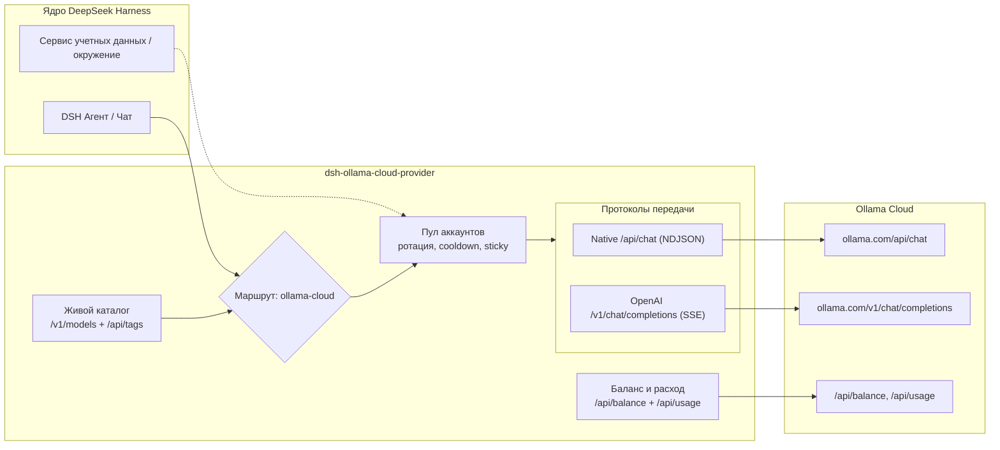

# 📦 @goodandready/dsh-ollama-cloud-provider

<div align="center">

<h3>Плагин-провайдер Ollama Cloud для DeepSeek Harness</h3>

<p>
  <a href="https://goodandready.app/"></a>
  <a href="https://www.npmjs.com/package/@goodandready/dsh-ollama-cloud-provider"></a>
  <a href="https://github.com/GooDAnDReaDY/dsh-ollama-cloud-provider/blob/main/LICENSE"></a>
</p>

</div>

<table align="center">
  <tr>
    <td align="center">
      ⭐ <strong>Если вам нравится этот плагин, поставьте ему Star на GitHub</strong> — это покажет мне, что плагин полезен, и добавит мотивации продолжать его развитие.
      <br><br>
      🐛 <strong>Если вы нашли баг или хотите предложить новую функцию</strong>, создайте Issue на GitHub на любом языке — я рассмотрю предложение и реализую полезные улучшения в одной из следующих версий плагина.
    </td>
  </tr>
</table>

---

Плагин-провайдер **Ollama Cloud** для [DeepSeek Harness](https://deepseek-harness.github.io/deepseek-harness/) (dsh).

Плагин регистрирует один нативный LLM-маршрут `ollama-cloud` (`https://ollama.com`) и поддерживает два протокола передачи данных:

| Транспорт | Эндпоинт | Назначение |
|---|---|---|
| `native` (по умолчанию) | `POST /api/chat` | thinking, вызовы инструментов (tool calls), счётчики usage (NDJSON) |
| `openai-chat` | `POST /v1/chat/completions` | Совместимость с OpenAI API и резервный транспорт (SSE) |

Ключи разрешаются динамически на каждый вызов: смена credential применяется мгновенно без перезапуска сервера.

## Архитектура



## Полный обзор возможностей

- **Два транспорта**, выбираемые индивидуально для каждой модели: нативный протокол Ollama API (NDJSON) и совместимый шлюз OpenAI (SSE).
- **Поддержка всех режимов**: текст, reasoning/thinking, вызовы функций/инструментов, изображения (vision), подсчёт токенов и finish reasons на обоих транспортах.
- **Живой каталог моделей**: автоматическое чтение `GET /v1/models`, дополненное флагами возможностей `capabilities` (`tools`, `thinking`, `vision`) из `GET /api/tags`.
- **Точные лимиты и метаданные**: контекстное окно, входные модальности, уровни reasoning и значение по умолчанию, статус поддержки инструментов и видимость в API.
- **Баланс и аналитика расхода**: интеграция с официальными облачными эндпоинтами `/api/balance` и `/api/usage` — включённые и купленные кредиты, расход за 24 часа / 7 дней / 30 дней, а также группировка по моделям.
- **Пул аккаунтов с авто-ротацией до первого токена**: при получении 401, 403, 429 или ответа об исчерпании квоты ключ переводится в cooldown, а запрос автоматически перенаправляется на следующий доступный аккаунт. Состояния cooldown сохраняются между перезапусками по SHA-256 fingerprint.
- **Sticky sessions**: закрепление одного аккаунта за конкретным диалогом, плюс гибкие правила `модель ➔ аккаунт` по glob-паттернам.
- **Оценка стоимости**: тарификация по официальному прайс-листу Ollama Cloud, включая ночные скидки (off-peak rates) и возможность ручного переопределения цен на модель.
- **Интерфейс в браузере (Web UI)**:
  - **Настройки → Ollama Cloud**: управление ключами, отображение баланса, пул аккаунтов, правила маршрутизации, allowlist моделей, выбор транспорта.
  - **Карточка квоты в сайдбаре**: кольцевой индикатор с наиболее загруженным окном и детализацией остатка кредитов (по умолчанию выключена и не нагружает сеть фоновыми опросами; рядом с названием можно показать `planLabel`, например `PRO`).
  - **Центральная панель квот**: окна расходов, разбивка по моделям, трейс маршрутизации, аналитика токенов и интерактивный heatmap запросов.
- **Команда `/ollama`**: статус провайдера, квоты, баланс, список аккаунтов, моделей, правил и запуск тестового запроса `test [model]`.
- **Интеграция с терминалом (TUI)**: специальная секция настроек в терминальном режиме.
- **One-Click обновление плагина**: прямая проверка npm registry и кнопка обновления в Web UI.

## Установка

Сборка и упаковка из исходного кода:

```bash
npm install
npm run build
npm pack
```

Установка опубликованного пакета из npm:

```bash
dsh plugin --profile web add @goodandready/dsh-ollama-cloud-provider@0.1.9
# DSH Desktop:
dsh plugin --profile desktop add @goodandready/dsh-ollama-cloud-provider@0.1.9
```

Либо установка из упакованного tarball:

```bash
dsh plugin --profile web add /absolute/path/to/goodandready-dsh-ollama-cloud-provider-0.1.9.tgz
# DSH Desktop:
dsh plugin --profile desktop add /absolute/path/to/goodandready-dsh-ollama-cloud-provider-0.1.9.tgz
```

После установки перезапустите dsh (или DSH Desktop) и выберите **Ollama Cloud** в списке моделей.

## Конфигурация

```yaml
- id: llm-ollama-cloud
  name: "@goodandready/dsh-ollama-cloud-provider"
  config:
    apiKeyEnv: OLLAMA_API_KEY      # имя переменной или credential
    # apiKey: ...                  # только в composition, не коммитить в git
    transport: native              # native | openai-chat
    requestTimeoutMs: 300000
    streamIdleTimeoutMs: 300000
    visibleModels: []
    modelTransports: {}
    accounts:
      - label: Work
        apiKeyEnv: OLLAMA_API_KEY_2
    activeAccount: ''              # метка для принудительного закрепления
    stickySession: true
    showSidebarQuota: false
    planLabel: ''                  # необязательно, например PRO
```

Все поля, кроме `apiKey`, доступны для изменения в интерфейсе настроек DSH.

### Получение и хранение ключей

1. `config.apiKey` в файле конфигурации (`role('secret')`).
2. Системный сервис учетных данных DSH по имени `apiKeyEnv` (по умолчанию `OLLAMA_API_KEY`).
3. Переменные окружения процесса, `.env` проекта или `$DSH_HOME/.env`.

Ключ создается в личном кабинете: <https://ollama.com/settings/keys>. Ключи бессрочные; облачный API принимает только заголовок `Authorization: Bearer`.

### Пул аккаунтов и ротация

Дополнительный аккаунт добавляется в **Настройки → Ollama Cloud → Аккаунты**: укажите имя метки и credential reference (например, `OLLAMA_API_KEY_2`), вставьте токен и сохраните. Ротация происходит **строго до начала генерации потока**: отклонённый ключ получает cooldown, а запрос повторяется со следующим готовым аккаунтом.

Состояния cooldown сохраняются в `~/.dsh/storages/dsh-ollama/cooldowns.json` по SHA-256 хешу ключа.

### Правила привязки «модель ➔ аккаунт»

```yaml
modelAccountRules:
  - pattern: "*flash*"
    account: "Work"
```

Первый совпавший glob-паттерн направляет модель на указанный аккаунт, остальные аккаунты остаются в резерве.

## Баланс и мониторинг расхода

- `GET /api/balance` — поддерживает новый формат (`included.balance_usd`, `allowance_usd`, `period`, `purchased.balance_usd`) и legacy-формат (`session` / `weekly` с `remaining_percent`).
- `GET /api/usage?range=24h|7d|30d&group_by=model` — суммарные показатели и разбивка по моделям.

Эндпоинт `/api/usage` ограничен лимитом в **10 запросов в минуту**, поэтому баланс кэшируется на 60 секунд, статистика расхода — на 120 секунд. Фоновых опросов нет; временная недоступность квот не прерывает работу чата.

## Страница настроек Web UI

В разделе **Настройки → Ollama Cloud**:
- **Key**: статус ключа, вставка, очистка, кнопка **Test connection**.
- **Balance & Usage**: шкалы кредитов, окна расходов, предупреждения при 80% и 95%.
- **Accounts**: управление пулом дополнительных учетных записей.
- **Model rules**: настройка правил ротации по моделям.
- **Models**: поиск, принудительное обновление каталога моделей, allowlist, переопределение транспорта.
- **Connection**: базовые адреса, таймауты, лимиты токенов.
- **Plugin update**: проверка обновлений и кнопка **Update now**.

## Визуальная верификация

Настройки и баланс Ollama Cloud в интерфейсе DSH Desktop (темная тема):


## Команды CLI

```bash
/ollama status            # статус провайдера, квоты, модели
/ollama usage             # окна расходов и статистика по моделям
/ollama balance           # баланс кредитов
/ollama accounts          # список аккаунтов и их расход
/ollama models            # каталог моделей и параметры
/ollama rules             # правила модель ➔ аккаунт
/ollama test [model]      # проверочный запрос к модели
```

## Проверенные факты API (2026-10-21)

- `GET https://ollama.com/v1/models` возвращает стандартный `data[]` и расширенный массив `models[]` с метаданными контекста и модальностей.
- `GET https://ollama.com/api/tags` служит источником флагов `capabilities` по моделям.
- Нативный `/api/chat` передает NDJSON с подробной статистикой токенов в финальном объекте.
- Совместимый эндпоинт OpenAI `/v1/chat/completions` поддерживает стриминг, инструменты, зрение (vision) и `reasoning_effort`.

## Ограничения

- Только Ollama Cloud; локальный сервис `http://localhost:11434` данным плагином не регистрируется.
- Эмбеддинги (embeddings) в облачном API не предоставляются.
- Файловые вложения передаются текстовыми дескрипторами (handle), а не бинарными байтами.
- Интерфейс требует web-профиль; в терминальном TUI доступны команда `/ollama` и маршрут модели.

## Лицензия

MIT © [GooDAnDReaDY](https://github.com/GooDAnDReaDY). См. [LICENSE](./LICENSE) и [NOTICE](./NOTICE).
