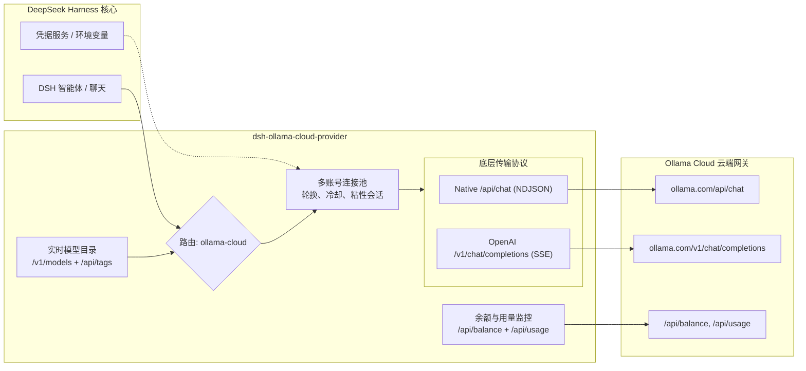
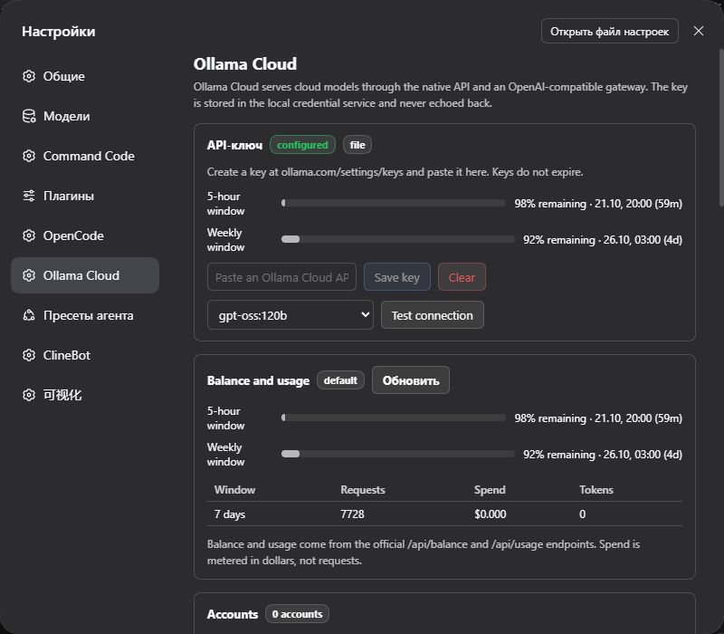

# 📦 @goodandready/dsh-ollama-cloud-provider

<div align="center">

<h3>面向 DeepSeek Harness 的 Ollama Cloud 模型提供商插件</h3>

<p>
  <a href="https://goodandready.app/"></a>
  <a href="https://www.npmjs.com/package/@goodandready/dsh-ollama-cloud-provider"></a>
  <a href="https://github.com/GooDAnDReaDY/dsh-ollama-cloud-provider/blob/main/LICENSE"></a>
</p>

</div>

<table align="center">
  <tr>
    <td align="center">
      ⭐ <strong>如果您喜欢这个插件，请在 GitHub 上为它点亮 Star</strong> — 这能让我知道插件对您有用，并鼓励我继续开发和维护它。
      <br><br>
      🐛 <strong>如果您发现 Bug 或希望增加功能</strong>，请使用任意语言在 GitHub 上提交 Issue — 我会评估您的建议，并在后续版本中实现有价值的改进。
    </td>
  </tr>
</table>

---

面向 [DeepSeek Harness](https://deepseek-harness.github.io/deepseek-harness/)（dsh）的 **Ollama Cloud** 模型提供商插件。

插件注册一个原生 LLM 路由 `ollama-cloud`（`https://ollama.com`），支持两种底层传输协议：

| 传输协议 | 端点 | 用途 |
|---|---|---|
| `native`（默认） | `POST /api/chat` | thinking、工具调用、usage 计数（NDJSON） |
| `openai-chat` | `POST /v1/chat/completions` | OpenAI 兼容部署与备用网关（SSE） |

密钥在每次请求时动态解析：在设置中更换凭据无需重启即可立即生效。

## 架构示意



## 功能全貌

- **两种底层传输协议**：按模型选择 Ollama 原生协议（NDJSON）或 OpenAI 兼容协议（SSE）。
- **全要素流式交互**：文本、深度思考（thinking）、工具调用、多模态图像、Token 统计与 finish reasons。
- **实时模型目录**：自动从 `GET /v1/models` 获取模型列表，并结合 `GET /api/tags` 补全能力标记（`tools`、`thinking`、`vision`）。
- **精准模型元数据**：上下文长度、输入模态、推理等级与默认配置、工具支持状态及 API 开放性。
- **官方余额与用量分析**：集成官方 `/api/balance` 与 `/api/usage`，呈现可用额度、已购额度、24小时/7天/30天支出及按模型细分报表。
- **多账号智能轮换**：在输出首个 Token 之前，遇到 401/403/429 或额度耗尽自动切换至备用账号。冷却时间通过 SHA-256 哈希安全持久化。
- **会话粘性与路由规则**：支持单会话锁定同一账号，以及基于 Glob 通配符的 `模型 → 账号` 绑定规则。
- **成本透明估算**：依据官方发布的价目表（包含闲时优惠折扣）进行费用估算，支持按模型覆盖价格。
- **Web UI 与交互卡片**：
  - **设置 → Ollama Cloud**：密钥配置、余额显示、账号池管理、模型白名单与协议切换。
  - **侧边栏配额指示卡片**：环形展示最高额度窗口（默认关闭且不产生后台轮询；可在名称旁显示 `planLabel`，例如 `PRO`）。
  - **中央用量分析面板**：支出窗口、请求热力图与用量走势。
- **`/ollama` 快捷指令**：快速查询状态、额度、余额、账号列表与执行联通性测试。
- **一键热更新**：在 DSH 设置页直接检测 npm 最新版本并快速安装更新。

## 安装指南

从源码构建与打包：

```bash
npm install
npm run build
npm pack
```

从 npm 安装已发布版本：

```bash
dsh plugin --profile web add @goodandready/dsh-ollama-cloud-provider@0.1.9
# DSH 桌面端：
dsh plugin --profile desktop add @goodandready/dsh-ollama-cloud-provider@0.1.9
```

或通过打包文件安装：

```bash
dsh plugin --profile web add /absolute/path/to/goodandready-dsh-ollama-cloud-provider-0.1.9.tgz
# DSH 桌面端：
dsh plugin --profile desktop add /absolute/path/to/goodandready-dsh-ollama-cloud-provider-0.1.9.tgz
```

安装完成后重启 dsh 或 DSH 桌面端，在模型列表中选择 **Ollama Cloud** 即可。

## 配置示例

```yaml
- id: llm-ollama-cloud
  name: "@goodandready/dsh-ollama-cloud-provider"
  config:
    apiKeyEnv: OLLAMA_API_KEY      # 环境变量名或 DSH 凭据名
    # apiKey: ...                  # 仅本地调试，严禁提交代码库
    transport: native              # native | openai-chat
    requestTimeoutMs: 300000
    streamIdleTimeoutMs: 300000
    visibleModels: []
    modelTransports: {}
    accounts:
      - label: Work
        apiKeyEnv: OLLAMA_API_KEY_2
    activeAccount: ''              # 固定指定活跃账号
    stickySession: true
    showSidebarQuota: false
    planLabel: ''                  # 可选，例如 PRO
```

除 `apiKey` 外的所有配置项均可在 DSH 设置页直接修改。

### 密钥配置

1. DSH 配置中的 `config.apiKey`。
2. DSH 凭据服务中的 `apiKeyEnv`（默认 `OLLAMA_API_KEY`）。
3. 环境变量或 `$DSH_HOME/.env`。

密钥可在官方后台生成：<https://ollama.com/settings/keys>。云端网关仅接受 `Authorization: Bearer` 请求头。

### 模型到账号路由规则

```yaml
modelAccountRules:
  - pattern: "*flash*"
    account: "Work"
```

## 界面与视觉验收

DSH Desktop（暗黑主题）中的 Ollama Cloud 设置与用量面板：



## 常用指令

```bash
/ollama status            # 查看服务商状态、配额与模型数
/ollama usage             # 7 天支出与按模型细分
/ollama balance           # 包含额度与充值额度
/ollama accounts          # 账号池健康与支出
/ollama models            # 模型目录与参数能力
/ollama rules             # 模型到账号规则
/ollama test [model]      # 发送连通性测试请求
```

## 限制与注意事项

- 仅支持 Ollama Cloud 云端模型；不会注册本地 `http://localhost:11434` 路由。
- 云端 API 暂不提供向量嵌入（Embeddings）模型。
- 文件附件以文本句柄（handle）形式转发。
- `/api/usage` 限制为每分钟 10 次请求，插件已内置本地缓存以确保顺畅使用。
- 完整功能需要 Web 配置文件；TUI 终端环境保留 `/ollama` 命令与模型推理。

## 许可证

MIT © [GooDAnDReaDY](https://github.com/GooDAnDReaDY)。详见 [LICENSE](./LICENSE) 与 [NOTICE](./NOTICE)。
